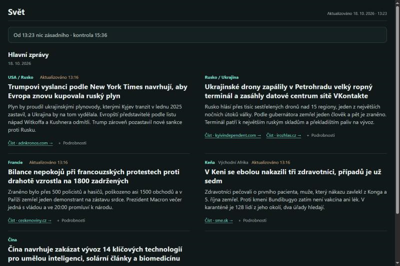
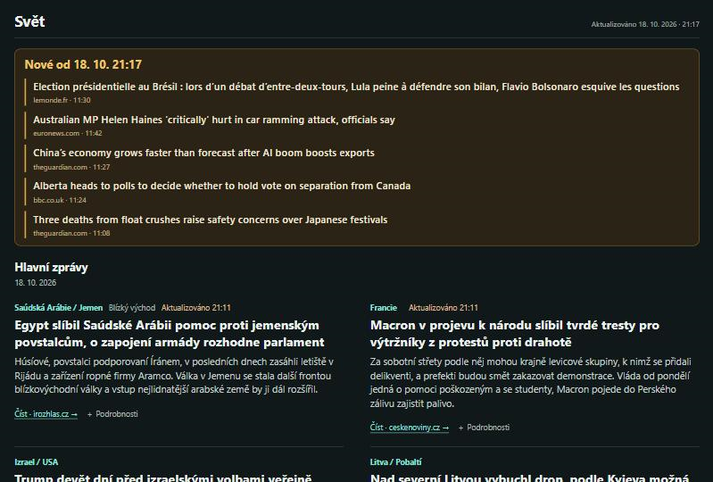
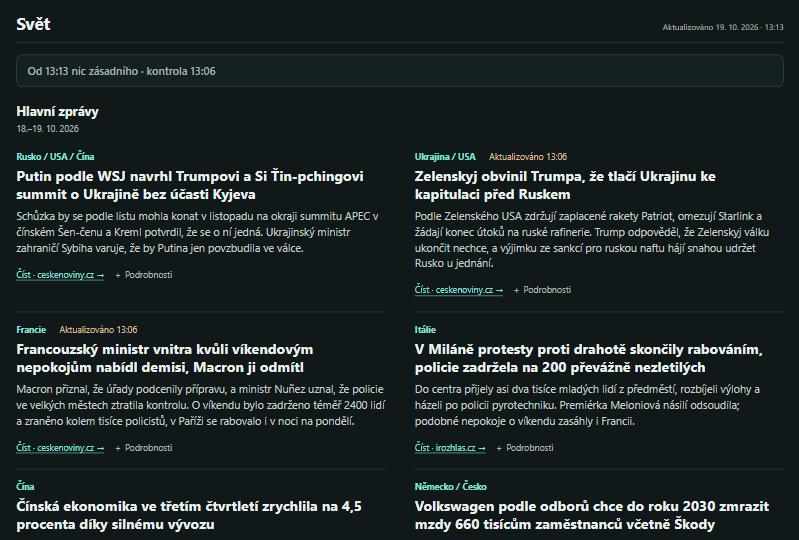

# Linuxový server pro sběr zpráv

Ze starého tabletu s Androidem jsem si udělal domácí server. Běží nepřetržitě a každých 15 minut stahuje nové články ze světových médií. Z nasbíraných zpráv vzniká přehled, který si může kdokoli přečíst na [mujlinux.cloud](https://mujlinux.cloud/).

Proč tablet: je tichý, má malou spotřebu a běží i při vypnutém počítači. Linuxové nástroje na něm zpřístupňuje aplikace Termux.



## Jak to celé funguje

```text
 Média (GDELT, RSS kanály)
        │ každých 15 minut
        ▼
 Tablet s Androidem ───── SSH ─────►  Pronajatý server s Ubuntu ─────► čtenáři webu
 (Termux, Python, SQLite)               (Nginx, HTTPS)
        │ zálohy                               ▲
        ▼                                      │ nová vydání přehledu
 Počítač s Windows ────────────────────────────┘
```

**Tablet (domácí server)** stahuje data, ukládá je do databáze a hledá v nich nová témata.

**Pronajatý server (VPS)** běží v datacentru a zpřístupňuje web na internetu. Čtenáři se připojují k němu, takže stránka funguje i ve chvíli, kdy je doma vypnutý počítač nebo nedostupný tablet.

**Počítač s Windows** slouží ke správě obou serverů, k přípravě nových vydání přehledu a k ukládání záloh.

Mezi vydáními posílá tablet na web každých 15 minut pruh **„Nové od…“** s titulky, které se od posledního vydání objevily u sledovaných redakcí. Čtenář tak vidí, že se něco děje, i než vyjde další vydání.

## Odkud přicházejí zprávy

- **GDELT**, veřejná databáze světového tisku. Každých 15 minut zveřejní záznamy o nových článcích z mnoha zemí a jazyků, včetně odkazů, zdrojů a témat.
- **Zpravodajské RSS kanály**, tedy průběžně doplňované seznamy titulků a odkazů přímo od médií. Patří mezi ně ČTK přes České noviny, iROZHLAS, SME a TASR, ale také BBC, Deutsche Welle, Euronews nebo rakouský ORF. Další pohled přidávají například brazilská Agência Brasil, tchajwanská CNA a indonéská ANTARA.

## Jak vzniká přehled a jakou roli má AI

Sběr na tabletu zajišťují programy v Pythonu podle pevných pravidel, bez AI. Při přípravě vydání pomáhá AI asistent Claude s návrhem témat, čtením původních článků a psaním krátkých textů. Výběr se řídí pravidly, která průběžně zpřesňuji, a ke každému vydání se ukládají důvody zařazení témat. Podrobnosti jsou v [metodice výběru a práce se zdroji](docs/methodology.md).

S asistenty Claude a Codex pracuji také na skriptech, opravách a dokumentaci. Zadávám jim úkoly a pravidla a rozhoduji, co se nasadí. Výstupy kontroluji a navržené změny ověřuji v prostředí projektu.

## Jak je to technicky řešené

- **Sběr dat – Python.** Programy opakovaně stahují nové podklady a zpracovávají je bez ručního kopírování.
- **Ukládání – SQLite a SQL.** Databáze drží záznamy o článcích. SQL dotazy umožňují data procházet a hlídají, že žádné čtvrthodinové stahování nechybí.
- **Vzdálená správa – SSH.** Servery spravuji z počítače přes šifrované spojení s přihlášením klíčem. Klíč tabletu smí na webovém serveru jen předat pruh „Nové od…“, nic jiného.
- **Veřejný web – Nginx a HTTPS.** Nginx doručuje stránku návštěvníkům. Certifikát Let's Encrypt zabezpečuje spojení a jeho obnovu hlídá naplánovaná úloha.
- **Vydávání webu.** Nová stránka se před zveřejněním ověří a předchozí vydání zůstává pro návrat. Kontrolní součet SHA-256 ověřuje, že soubory dorazily celé a beze změny.
- **Zálohy databáze.** Data se zálohují na počítač. Při zkoušce obnovy vznikne ze zálohy samostatná databáze a kontroluje se, že je neporušená a nic v ní nechybí.

## Přenos novinek na web

<details>
<summary>Ukázka přijímacího skriptu a testů</summary>

Tablet každých 15 minut pošle na externí server seznam nových titulků. Spojení jde přes SSH, ale klíč tabletu nesmí na serveru dělat nic jiného než spustit přijímací skript. Omezení klíče je nastavené v `authorized_keys`.

```text
restrict,command="/usr/bin/python3 -I -B …/nove_prijem.py" ssh-ed25519 … tablet
```

Přijímač kontroluje velikost a strukturu dávky, titulky, odkazy i časové údaje. Při neplatném vstupu dávku odmítne a na webu zůstane poslední dobrý stav. Položky z nepovolených domén vynechává.

```python
def clean(raw, now):
    if len(raw) > LIMIT:
        raise ValueError('velikost')
    data = json.loads(raw)
    items = data['items']
    if not isinstance(items, list) or len(items) > MAX_ITEMS:
        raise ValueError('položky')
    out, skipped = [], 0
    for i in items:
        title = ' '.join(str(i['title']).split())
        if not 5 <= len(title) <= 200 or re.search(r'[<>\x00-\x1f\x7f]', title):
            raise ValueError('titulek')
        url = str(i['url'])
        p = urlsplit(url)
        if (p.scheme != 'https' or p.port or p.username or p.password
                or len(url) > 300 or re.search(r'[\s"\'<>\\]', url)):
            raise ValueError('odkaz')
        first = when(i['first'], now)
        published = when(i.get('published') or i['first'], now)
        if not allowed(p.hostname):
            skipped += 1; continue
        out.append(dict(title=title, url=url, first=first, published=published))
    return dict(at=when(data['at'], now), received_at=now.isoformat(), items=out), skipped
```

Výsledek se zapíše do dočasného souboru a teprve potom se jedním krokem (`os.replace`) přejmenuje na ostrý, takže web nikdy nenačte napůl zapsaný soubor.

Skript [nove_web.py](scripts/nove_web.py) běží na tabletu a posílá data, [nove_prijem.py](scripts/nove_prijem.py) je přijímá na serveru. K oběma patří testy ([test_nove_web.py](scripts/test_nove_web.py), [test_nove_prijem.py](scripts/test_nove_prijem.py)), které zkouší i škodlivý vstup, například HTML v titulku, odkaz `javascript:` nebo podvržené domény.

```sh
cd scripts
python -m unittest test_nove_web test_nove_prijem test_verify_archive
```

</details>

## Příklad aktualizace webu

**Před aktualizací (19. 10. 2026, 13:00).** Pruh „Nové od 18. 10. 21:17“ ukazuje pět zpráv, které tablet od večerního vydání zachytil u sledovaných redakcí. Hlavní zprávy pod ním jsou ještě z večera.



**Po aktualizaci (13:13).** Při aktualizaci se prošly nasbírané podklady od večera a ke každému tématu se přečetl celý článek. Přibyla čtyři nová témata a tři dosavadní se posunula, ostatní bez vývoje vypadla. Pruh nahoře hlásí, že od vydání nic zásadního nepřibylo.



## Ukázky a podrobnosti

- [Provoz webu](docs/web.md) – HTTPS, přenos vydání a omezení přístupu.
- [Ukázka záchrany zálohy](docs/backup.md) – obnova databáze z archivu a její kontrola.
- [Diagnostika přenosů přes Wi-Fi a USB](docs/incident-wifi.md).
- [Kontrola zálohy v Pythonu](scripts/verify_archive.py) a [výsledek nad skutečnými daty](examples/archive-verification.json).
- [SQL dotazy](examples/coverage.sql) – kontrola úplnosti dávek a zastoupení jazyků.
